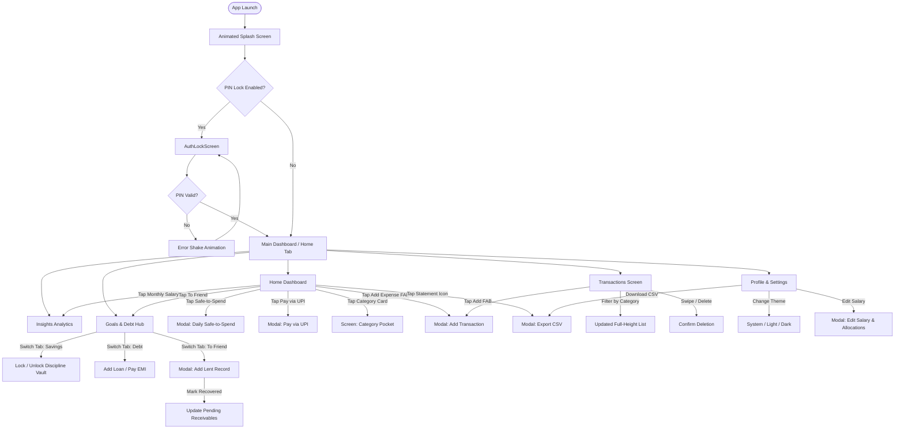
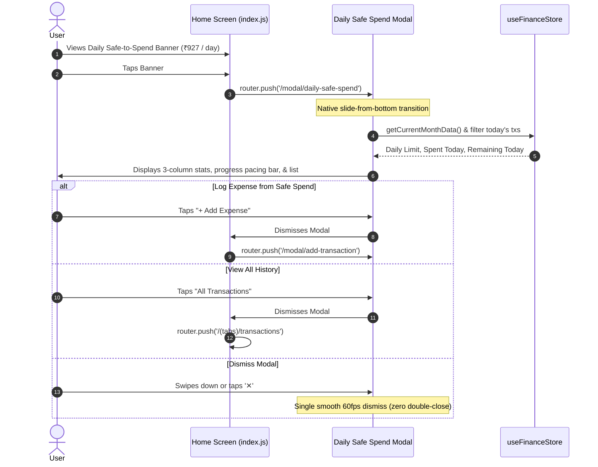
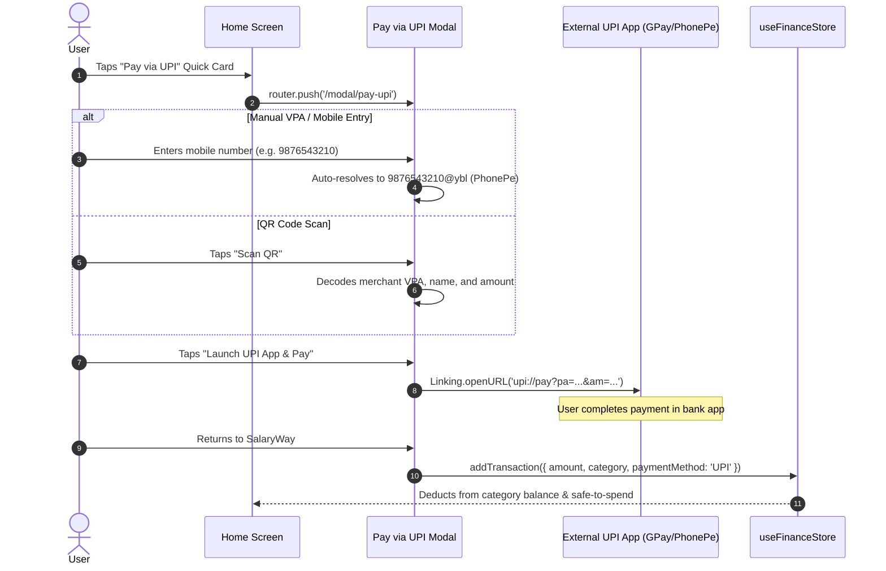
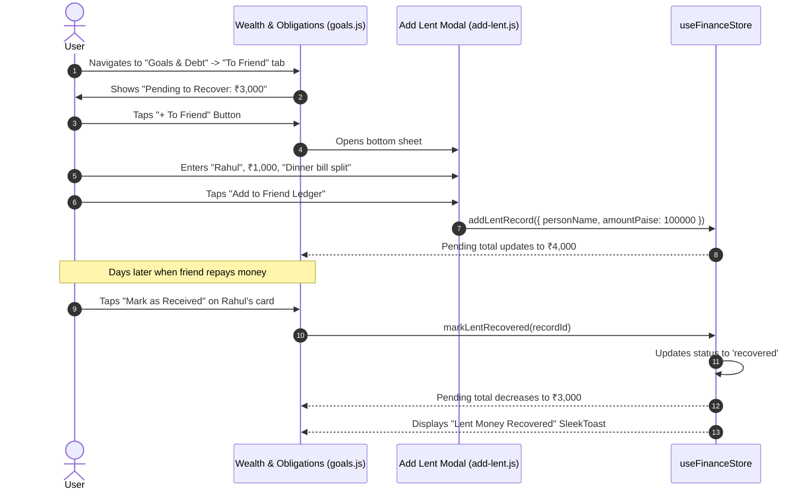
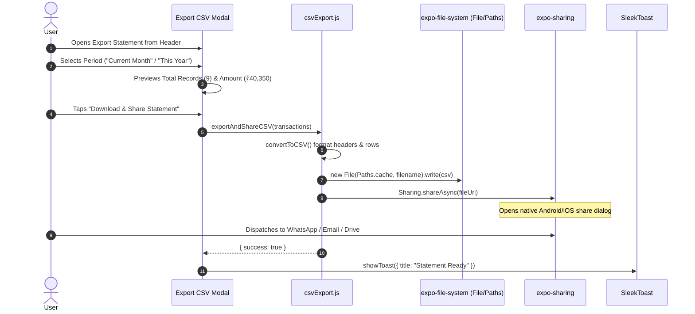

# Application Flow & User Journeys (APPFLOW)
## SalaryWay — Interaction Design & Routing Architecture

---

## 1. Route Hierarchy & Navigation Architecture

SalaryWay utilizes **Expo Router** with a combination of a persistent Tab Navigator and full-screen / card Modal presentations.

```
src/app/
├── _layout.js                     # Root Stack Navigator + Splash & Security Lock
├── (tabs)/
│   ├── _layout.js                 # 4-Tab Bottom Bar (Home, Transactions, Insights, Goals)
│   ├── index.js                   # Home Dashboard Screen
│   ├── transactions.js            # All Transactions & Category Filter Screen
│   ├── insights.js                # Financial Analytics & Spending Charts
│   ├── goals.js                   # Wealth & Obligations (Vault, Debt, Udhaar)
│   └── profile.js                 # User Settings, Preferences & Allocation Rules
├── category/
│   └── [id].js                    # Pocket Drilldown (Essential, Lifestyle, etc.)
└── modal/
    ├── daily-safe-spend.js        # Dedicated Daily Safe-to-Spend Pacing View
    ├── add-transaction.js         # New Expense / Income Logging
    ├── pay-upi.js                 # UPI Quick Pay, QR Scanner & Contact Handle
    ├── export-statement.js        # CSV Statement Generator & Share
    ├── edit-salary.js             # Base Salary & Allocation Editor
    └── add-lent.js                # Peer Money Lent ("To Friend") Logger
```

---

## 2. Complete Application Flowchart



---

## 3. Detailed User Journeys

### 3.1 Daily Safe-to-Spend Pacing Flow



---

### 3.2 Instant UPI Payment & Deep-Linking Flow



---

### 3.3 Peer Lending ("To Friend" Udhaar) Recovery Flow



---

### 3.4 CSV Statement Generation & Sharing Flow


